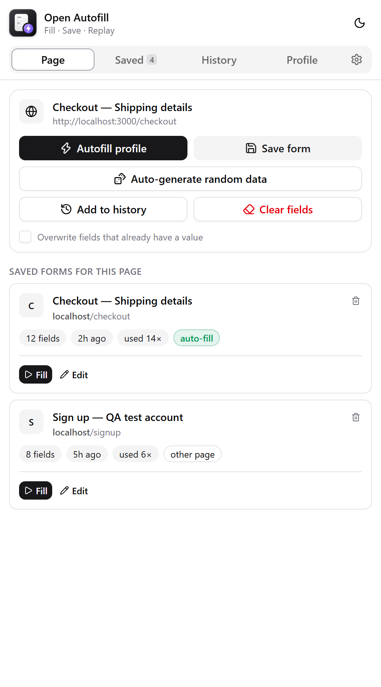
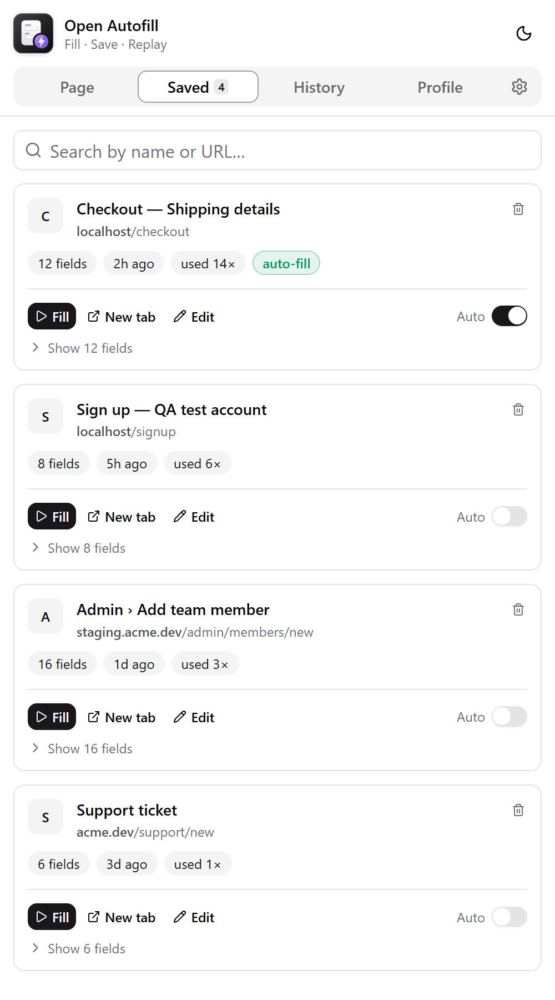
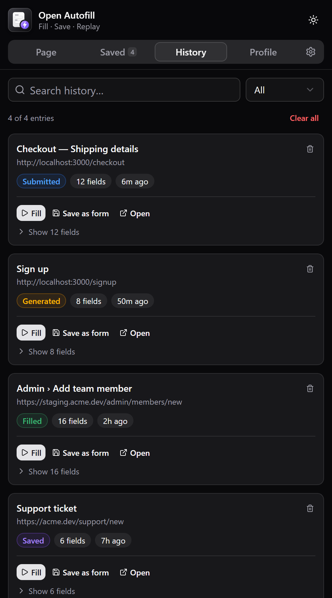

<div align="center">


# Open Autofill

**Fill any form in one click.**

Autofill forms, generate realistic test data, and save & replay filled forms — right from Chrome's side panel.

[](https://github.com/harshilsureja/open-autofill/actions/workflows/ci.yml)
[](https://github.com/harshilsureja/open-autofill/releases/latest)
[](LICENSE)


[**Website**](https://harshilsureja.github.io/open-autofill/) ·
[**Download**](https://github.com/harshilsureja/open-autofill/releases/latest) ·
[**Report a bug**](https://github.com/harshilsureja/open-autofill/issues/new?template=bug_report.md)

<br />





</div>

---

## Why Open Autofill?

If you build or test web apps, you fill the same forms dozens of times a day — sign-ups, checkouts, admin screens.
Open Autofill remembers them for you. Fill once, save, and replay with a single click. Everything stays on your machine.

## Features

| | |
|---|---|
| ⚡ **Profile autofill** | Store your details once; fields are matched by `autocomplete`, name, id, label and placeholder. |
| 🎲 **Realistic test data** | One click fills every field with a consistent fake person — offline generator or [randomuser.me](https://randomuser.me) by nationality. |
| 💾 **Save & replay** | Save a filled form with its URL. Click **Fill** later and the extension navigates there and restores every value. |
| 🔁 **Auto-fill on load** | Toggle per saved form to fill automatically whenever that URL opens. |
| 🕘 **Full history** | Every submit, save, fill and generation is logged — searchable, filterable, re-fillable. |
| 🧩 **Per-tab side panel** | Lives in Chrome's native side panel, only on the tab where you opened it. |
| ⚛️ **Framework friendly** | Native value setters + real `input`/`change` events, so React, Vue, Angular and Svelte forms update correctly. |
| 🔒 **Private by design** | Data lives in `chrome.storage.local`. Passwords, hidden and file inputs are never captured. |
| 📦 **Export / import** | Back up or move everything as JSON. Imports merge instead of overwrite. |
| 🌗 **Light & dark** | Clean shadcn/ui interface in both themes. |

## Install

### Option 1 — Download a release (recommended)

1. Download `open-autofill-vX.Y.Z.zip` from the [latest release](https://github.com/harshilsureja/open-autofill/releases/latest) and unzip it.
2. Open `chrome://extensions` and turn on **Developer mode** (top-right).
3. Click **Load unpacked** and select the unzipped folder.
4. Pin the extension from the 🧩 menu.

### Option 2 — Build from source

Requires Node.js 20.19+ (22 LTS recommended).

```bash
git clone https://github.com/harshilsureja/open-autofill.git
cd open-autofill
npm install
npm run build
```

Then **Load unpacked** → select the generated `dist/` folder.

> Works in any Chromium browser with side panel support: Chrome 116+, Edge, Brave, Arc, Opera.

## How to use

1. **Open the panel** — click the extension icon. The side panel opens for the current tab.
2. **Fill**
   - **Autofill profile** uses the details from the *Profile* tab.
   - **Auto-generate random data** fills every empty field with a believable fake person.
   - Tick *Overwrite fields that already have a value* to replace existing input.
3. **Save** — click **Save form**, name it, and optionally enable *Auto-fill when this URL opens*.
4. **Replay** — open the **Saved** or **History** tab and hit **Fill**. If you're on a different page, it navigates to the saved URL first.

**Tips**

- **Edit** a saved form to tweak individual values, rename it, or change its URL.
- Submitted forms are logged to **History** automatically; turn this off in **Settings**.
- In **Settings → Random data**, switch to `randomuser.me` and pick nationalities (e.g. `us,gb,in`) for region-accurate names, addresses and phone numbers.
- **Profile → Custom fields** handle site-specific inputs: if a field's name or label contains the key, its value is used.

## Development

```bash
npm install
npm run dev       # rebuilds dist/ on every save — click reload on chrome://extensions
npm run build     # type-check + production build
npm run zip       # build and pack release/open-autofill-v<version>.zip
npm run icons     # re-render PNG icons from assets/logo*.svg
```

### Project structure

```
├─ public/              copied as-is into dist/
│  ├─ manifest.json
│  ├─ background.js     per-tab side panel, history writes
│  ├─ content.js        capture, fill, profile autofill, random data
│  └─ faker.js          offline test-data generator (shared)
├─ src/                 React side panel (TypeScript)
│  ├─ components/       tabs, cards, dialogs, ui/ (shadcn)
│  ├─ hooks/            chrome.storage + panel tab sync
│  └─ lib/              chrome plumbing, store actions, types
├─ assets/              logo sources
├─ scripts/             icon + zip build scripts
└─ docs/                GitHub Pages website
```

**Stack:** React 19 · TypeScript · Tailwind CSS v4 · shadcn/ui · Vite · Chrome Manifest V3

Add more shadcn components with `npx shadcn@latest add <component>`.

## Releasing

1. Bump `version` in `public/manifest.json` and `package.json`.
2. Commit, then tag and push:
   ```bash
   git tag v1.0.1
   git push origin v1.0.1
   ```
3. The **Release** workflow builds the extension and attaches `open-autofill-v1.0.1.zip` to a GitHub release.
4. For the Chrome Web Store, upload that same zip in the [Developer Dashboard](https://chrome.google.com/webstore/devconsole).

## Privacy

The extension has no servers, analytics or accounts. See [PRIVACY.md](PRIVACY.md).

## Contributing

Issues and pull requests are welcome — see [CONTRIBUTING.md](CONTRIBUTING.md).

## License

[MIT](LICENSE) © Harshil Sureja
